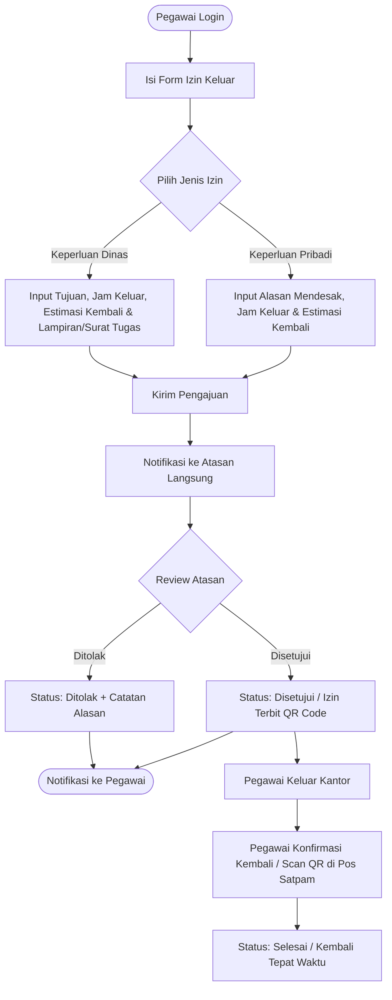

# E-IZIN PA Gunung Sugih
### Sistem Informasi Permohonan & Persetujuan Izin Keluar Kantor Berbasis Web
**Pengadilan Agama Gunung Sugih**

---

## 📌 1. Latar Belakang & Deskripsi

Dalam rangka meningkatkan kedisiplinan, tertib administrasi kepegawaian, serta efektivitas pelayanan publik di lingkungan **Pengadilan Agama Gunung Sugih**, diperlukan sistem digital untuk mengelola dan memantau izin keluar pegawai pada jam dinas/kerja.

**E-IZIN** adalah aplikasi berbasis web yang menggantikan prosedur izin keluar manual (berbasis kertas/konvensional) menjadi proses digital yang cepat, transparan, dan akuntabel. Aplikasi ini memfasilitasi pegawai untuk mengajukan izin keluar dan memfasilitasi atasan langsung (ketua jabatan / pimpinan) untuk memverifikasi serta memberikan persetujuan (*approval*) secara *real-time*.

---

## 🎯 2. Tujuan Aplikasi

1. **Efisiensi Birokrasi**: Menghilangkan penggunaan formulir kertas (*paperless*) dan mempercepat alur izin tanpa harus mencari pejabat penandatangan secara tatap muka.
2. **Monitoring Real-time**: Memudahkan Bagian Kepegawaian (Subbag Kepegawaian, Organisasi, dan Tata Laksana) serta Pimpinan untuk mengetahui siapa saja pegawai yang sedang berada di luar kantor pada saat jam kerja.
3. **Akuntabilitas & Rekapitulasi**: Menyediakan arsip digital lengkap dengan rekam jejak waktu keluar, waktu kembali, serta alasan keperluan (dinas atau pribadi).

---

## 👥 3. Peran Pengguna (User Roles) & Hak Akses

| Peran (Role) | Deskripsi | Hak Akses Utama |
| :--- | :--- | :--- |
| **Pegawai (Pemohon)** | Seluruh aparatur sipil/honorer di PA Gunung Sugih. | - Mengajukan permohonan izin keluar kantor.<br>- Melihat status persetujuan (Menunggu / Disetujui / Ditolak).<br>- Melakukan konfirmasi "Kembali ke Kantor" (*check-in*).<br>- Melihat riwayat izin pribadi. |
| **Atasan Langsung / Pejabat Penyetuju** | Ketua, Wakil Ketua, Panitera, Sekretaris, Hakim, Panmud, dan Kasubbag. | - Menerima notifikasi permohonan izin dari bawahan langsung.<br>- Meninjau alasan, jam, dan lampiran permohonan.<br>- Memberikan tindakan: **Setujui (Approve)** atau **Tolak (Reject)** dengan catatan. |
| **Admin / Subbag Kepegawaian** | Pengelola data kepegawaian dan sistem. | - Manajemen data master pegawai, jabatan, unit kerja, dan hierarki atasan.<br>- Dashboard monitoring pegawai yang sedang izin di luar.<br>- Rekapitulasi laporan per periode (harian/mingguan/bulanan) dan ekspor data (PDF/Excel). |
| **Petugas Keamanan / Satpam** *(Opsional)* | Petugas di pos gerbang / resepsionis. | - Validasi tiket/QR Code izin pegawai saat keluar dan kembali ke gerbang pengadilan. |

---

## ⚡ 4. Alur Proses Bisnis (Workflow)



---

## 🚀 5. Fitur-Fitur Utama

### 📱 A. Modul Pegawai (Self-Service)
- **Form Pengajuan Fleksibel**:
  - Jenis Izin: *Dinas Luar (Tugas/Sidang Keliling/Koordinasi)* atau *Urusan Pribadi Mendesak*.
  - Pemilihan waktu: Jam keluar dan estimasi jam kembali.
  - Alasan izin dan upload dokumen pendukung (jika ada).
- **Status Tracker**: Indikator langsung apakah pengajuan masih pending, disetujui, atau ditolak.
- **Kartu/Tiket Izin Digital (QR Code)**: Bukti resmi bahwa pegawai telah memperoleh izin atasan.
- **Tombol Konfirmasi Kembali**: Tombol sekali klik saat pegawai sudah tiba kembali di kantor.

### ✍️ B. Modul Approval Atasan
- **Inbox Permohonan Masuk**: Daftar antrean permohonan izin yang membutuhkan tindakan cepat.
- **One-Click Approval**: Persetujuan cepat langsung dari dashboard atau tautan cepat.
- **Catatan Penolakan/Disposisi**: Memberi catatan jika izin tidak diizinkan atau membutuhkan penyesuaian jam.

### 📊 C. Modul Admin & Kepegawaian (Monitoring & Laporan)
- **Live Board "Who's Out"**: Menampilkan daftar nama pegawai yang sedang berada di luar kantor secara langsung.
- **Hierarki Jabatan Dinamis**: Pengaturan hierarki atasan bawahan sesuai bagan struktur organisasi PA Gunung Sugih.
- **Export & Laporan**: Laporan riwayat izin format PDF/Excel untuk bahan evaluasi kinerja atau integrasi presensi.
- **Notifikasi**: Dukungan notifikasi in-app dan integrasi WhatsApp Gateway / Telegram Bot (opsional).

---

## 📝 Formulir Permohonan Izin Pegawai:
1. **Pilih Ketua Jabatan Perizinan** (Ketua Pengadilan Agama Gunung Sugih)
2. **Nama Pemohon & NIP Pemohon** (Otomatis terisi dari sesi login)
3. **Jabatan Pemohon**
4. **Tanggal Izin**
5. **Jam Keluar & Jam Masuk Kantor**
6. **Keterangan Keperluan Izin**
7. **Tanda Tangan Digital (TTD Digital)**: Goreskan tanda tangan langsung dengan jari/stylus di layar
8. **Tombol Kirim**: Dikirim langsung ke antrean persetujuan Ketua Jabatan

---

## 👥 Akun Contoh untuk Masuk (Login Menggunakan Nama & NIP):
1. **Akun Pegawai**:
   - **Nama**: `Ahmad Fauzi`
   - **NIP**: `199208152019031002`
   - **Hak Akses**: Mengajukan izin, melihat status, cetak/download surat PDF resmi, check-in kembali saat tiba di kantor, dan menghapus permohonan yang masih Menunggu. *(Pegawai biasa tidak dapat menyetujui/menolak izin)*.
2. **Akun Ketua Jabatan (Khusus Approval & Penandatanganan Digital)**:
   - **Nama**: `Dr. H. Ahmad Zarkasi, S.H.I., M.H.` (atau ketik `Ahmad Zarkasi`)
   - **NIP**: `197405102001121001`
   - **Hak Akses Khusus**: Panel khusus untuk meninjau antrean permohonan izin keluar kantor pegawai, menyetujui izin dengan membubuhkan **Tanda Tangan Digital Resmi**, atau menolak permohonan dengan catatan alasan.

---

## 📄 Format Surat Izin Resmi & Download PDF:
- Mengikuti template resmi Pengadilan Agama Gunung Sugih:
  - **Kop Surat**: Lambang Mahkamah Agung RI, Ditjen Badilag, PTA Bandar Lampung, PA Gunung Sugih, Jalan Negara No. 99 Gunung Sugih, Lampung Tengah, Lampung 34161, (0725) 528885.
  - **Garis Ganda Kop (Thick-Thin Double Line)**.
  - **Judul**: `IZIN KELUAR KANTOR`.
  - **Tabel Isi**: Yang bertandatangan di bawah ini, Dengan ini memberikan izin kepada, Untuk keluar kantor pada, Untuk keperluan.
  - **Dua Kolom Tanda Tangan**: Pemohon (kiri) & Ketua Pengadilan Agama Gunung Sugih (kanan) lengkap dengan tanda tangan digital dan NIP masing-masing.
  - **Download Surat Format PDF**: Tombol sekali klik untuk mengunduh dokumen siap cetak dalam ukuran A4.

---

## 🛠️ 6. Teknologi Stack yang Digunakan

Aplikasi ini dibangun menggunakan **Node.js**:
- **Runtime & Backend Framework**: Node.js v18+ / v24+ dengan **Express 5**
- **Data Persistence**: JSON Storage Engine dengan atomicity (mudah dimigrasi ke MySQL/PostgreSQL bila diperlukan)
- **Frontend & UI**: HTML5, Tailwind CSS (Modern, Clean & Responsive), Lucide Icons, Plus Jakarta Sans & JetBrains Mono
- **QR Code Engine**: `qrcode` generator untuk verifikasi tiket izin digital
- **File Upload**: Multer (upload surat tugas & dokumen pendukung)

---

## 💻 7. Cara Menjalankan Aplikasi

1. **Pastikan Node.js dan npm sudah terpasang** (minimal Node.js v18+).
2. **Install dependensi** (jika belum):
   ```bash
   npm install
   ```
3. **Jalankan server aplikasi**:
   ```bash
   npm start
   ```
   *Atau mode auto-reload untuk pengembangan:*
   ```bash
   npm run dev
   ```
4. **Buka di browser**:
   Kunjungi [http://localhost:3000](http://localhost:3000)

---

## 📂 8. Struktur Direktori Proyek

```text
APP IZIN/
├── data/
│   ├── pegawai.json       # Master data pegawai & atasan PA Gunung Sugih
│   ├── izin.json          # Database permohonan izin & riwayat
│   └── uploads/           # Penyimpanan berkas lampiran/surat tugas
├── public/
│   ├── css/
│   │   └── style.css      # Custom styling, print styles tiket, glassmorphism
│   ├── js/
│   │   └── app.js         # Logika interaktif frontend, kalkulator durasi, API calls
│   └── index.html         # Tampilan web pegawai (clean & modern)
├── routes/
│   └── api.js             # REST API endpoint permohonan, status, check-in, dan approval
├── services/
│   └── storage.js         # Service pengelola data & QR code generator
├── server.js              # Server entrypoint Express
├── package.json
└── README.md
```

---

## 📋 9. Rencana Tahapan Pengembangan (Roadmap)

- [x] **Fase 1: Perencanaan & Dokumen Spesifikasi (`README.md`)**
- [x] **Fase 2: Versi Pegawai (Frontend Modern & Backend Node.js)**
  - [x] Antarmuka Pegawai bersih, modern, dan responsif.
  - [x] Switcher akun pegawai (Ahmad Fauzi, Siti Rahmawati, Bambang Pratama, Nurul Hidayah).
  - [x] Formulir pengajuan izin dinas & pribadi dengan kalkulator durasi otomatis.
  - [x] Kartu Izin Aktif (*Live Active Card*) dengan status real-time.
  - [x] E-Tiket Digital resmi dengan Kop Surat PA Gunung Sugih & QR Code verifikasi.
  - [x] Fitur Konfirmasi Tiba di Kantor (*Check-in Kembali*).
  - [x] Riwayat permohonan dengan pencarian, filter status & jenis.
  - [x] Tombol simulasi approval atasan untuk kemudahan demonstrasi alur.
- [ ] **Fase 3: Versi Approval Atasan Langsung (Ketua Jabatan / Pimpinan)**
  - [ ] Dashboard antrean persetujuan per atasan.
  - [ ] One-click approve/reject dengan catatan disposisi.
  - [ ] Notifikasi permohonan masuk.
- [ ] **Fase 4: Modul Monitoring Kepegawaian & Pos Keamanan**
  - [ ] Live monitoring siapa saja pegawai yang sedang di luar kantor.
  - [ ] Scanner QR Code untuk pos satpam / gerbang.
  - [ ] Ekspor rekapitulasi izin bulanan (Excel/PDF).

---

## 🏛️ Instansi Pemilik
**Pengadilan Agama Gunung Sugih**  
Wilayah Hukum Pengadilan Tinggi Agama Bandar Lampung  
Mahkamah Agung Republik Indonesia  

---

## 📄 Lisensi & Hak Cipta (License)
Aplikasi ini dikembangkan dan dilisensikan di bawah **[MIT License](LICENSE)**:  
**Rofid Safwanda**  
Copyright © 2026 **Rofid Safwanda**.

Lihat berkas [LICENSE](LICENSE) untuk ketentuan lisensi selengkapnya.

---
*Dibuat untuk kebutuhan operasional dan modernisasi layanan kepegawaian internal PA Gunung Sugih.*

